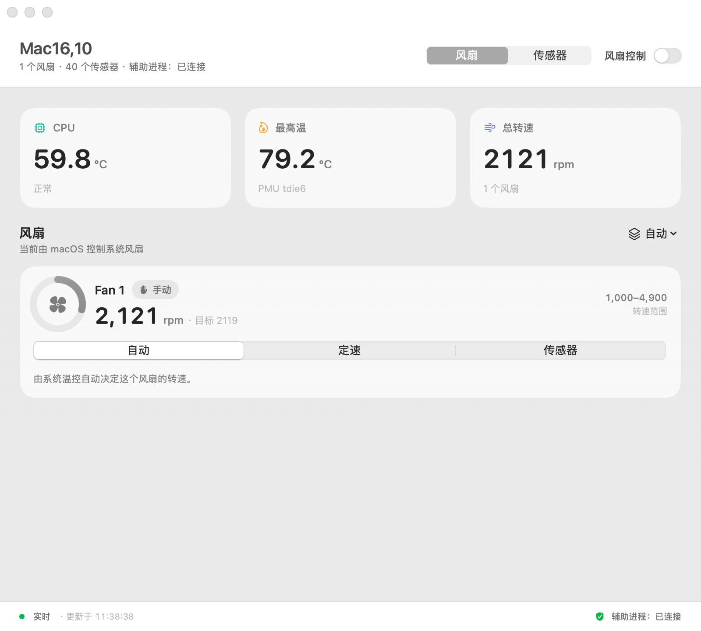

# FanKit

A native SwiftUI fan controller for Apple Silicon Macs.

FanKit reads the SMC and the HID thermal sensors directly through IOKit, shows
live temperatures in the menu bar, and lets a small privileged helper drive fan
speed. The UI is SwiftUI with a menu-bar extra, Simplified Chinese and English
localisation, and no third-party dependencies.



## What it does

- Live CPU average, hottest sensor, and total airflow, refreshed every second.
- 40 thermal sensors grouped by subsystem on Apple Silicon.
- Per-fan control: automatic, constant speed, or a temperature curve.
- Named presets with an import and export string format.
- Menu-bar readout with a two-line temperature/RPM display and a popover panel.
- A launchd helper that restores automatic control if the app stops responding.

## Requirements

- macOS 14 or newer, Apple Silicon.
- Xcode 15 or newer to build.
- Administrator rights once, to install the helper into
  `/Library/PrivilegedHelperTools`.

## Build and run

```bash
./Scripts/build-app.sh release
open dist/FanKit.app
```

The script builds the Swift package, assembles `dist/FanKit.app` (app binary,
helper, `Info.plist`, localisations, icon), and signs it ad hoc. The app installs
its helper on first launch and asks for your password once.

Command-line smoke test:

```bash
swift run fankitctl
```

Tests:

```bash
swift test
```

## Layout

| Path | Contents |
| --- | --- |
| `Sources/FanKitCore/SMC` | `AppleSMC` IOKit client, key struct, data codecs |
| `Sources/FanKitCore/Fans` | Fan discovery and fan writes |
| `Sources/FanKitCore/Sensors` | HID and SMC temperature sources |
| `Sources/FanKitCore/Control` | Control engine: ramp, deadband, rate limit |
| `Sources/FanKitCore/Presets` | Preset model and wire format |
| `Sources/FanKitCore/Helper` | XPC protocol, client, installer |
| `Sources/FanKitHelper` | Root launchd daemon |
| `Sources/FanKitApp` | SwiftUI app, menu bar, views |
| `Sources/CHIDTemperature` | C shim for the HID thermal event call |

## Safety

Fan writes require the helper, and the helper only accepts connections from a
process inside a `FanKit.app` bundle. If the app stops sending heartbeats for
20 seconds, the helper sets every fan back to automatic control. Quitting the app
releases the fans before the process exits.

Fan control is inherently risky: a curve with a high start temperature can let
the machine run hot. Start conservatively and watch the temperatures.

## Licence

MIT. See `LICENSE`.
